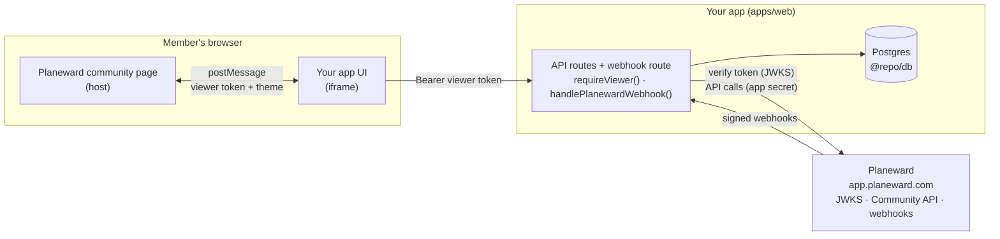

# Planeward App Template

A starter for building Planeward Community Apps: third-party Next.js apps that Planeward shows in an iframe inside a community. Your app appears as a **member channel** (`/experience`) and a **staff dashboard** (`/dashboard`), and gets:

- a verified viewer identity (short-lived signed token from the host),
- a typed API client for the Planeward API,
- signed webhooks (`app.installed`, `app.uninstalled`, and more).

## Layout

| Path                                                             | Package              | What it is                                                                                |
| ---------------------------------------------------------------- | -------------------- | ----------------------------------------------------------------------------------------- |
| `apps/web`                                                       | `@repo/web`          | Next.js app on port 3005: setup page, experience, dashboard, API routes                   |
| `packages/app-sdk`                                               | `@planeward/app-sdk` | Public SDK: iframe handshake, token verification, webhooks, API client (builds to `dist`) |
| `packages/planeward`                                             | `@repo/planeward`    | React provider/hooks and server helpers (`requireViewer`, `handlePlanewardWebhook`)       |
| `packages/db`                                                    | `@repo/db`           | Drizzle schema, client and migrations                                                     |
| `packages/ui`                                                    | `@repo/ui`           | shadcn/ui components and the Tailwind v4 theme                                            |
| `packages/typescript-config`, `eslint-config`, `prettier-config` | `@repo/*-config`     | Shared configs                                                                            |

## Quickstart

Requires Node 24+, pnpm 11, Docker and a tunnel ([cloudflared](https://developers.cloudflare.com/cloudflare-one/connections/connect-networks/downloads/) or [ngrok](https://ngrok.com/download)).

Planeward is hosted at `https://app.planeward.com`. It loads your app in an iframe and sends it webhooks, so it must reach your app over public `https`; `localhost` URLs are rejected. During development, expose your dev server through a tunnel.

1. Install and start the app:

   ```bash
   pnpm install
   cp .env.example .env
   docker compose up -d   # Postgres on :5433
   pnpm db:migrate
   pnpm dev               # app on http://localhost:3005
   ```

2. In another terminal, start a tunnel to port 3005:

   ```bash
   cloudflared tunnel --url http://localhost:3005   # prints https://<random>.trycloudflare.com
   # or
   ngrok http 3005                                  # prints https://<random>.ngrok-free.app
   ```

3. Put the tunnel **hostname** (no `https://`, no path) in `.env`, then restart `pnpm dev`:

   ```bash
   ALLOWED_DEV_ORIGINS="abc-123.trycloudflare.com"
   ```

   Next.js only serves dev assets to `localhost` and the hosts listed here. Without it the app loads inside Planeward but never connects.

4. Open the setup page through the tunnel (`https://abc-123.trycloudflare.com/`). It shows which env vars are set and the exact URLs to register.

## Register in Planeward

1. In **Settings › Apps › Developer**, create an app with your tunnel origin:
   - Experience URL: `https://abc-123.trycloudflare.com/experience`
   - Dashboard URL: `https://abc-123.trycloudflare.com/dashboard`
   - Webhook URL: `https://abc-123.trycloudflare.com/api/webhooks/planeward`
   - Both scopes: **Community — read members** (`COMMUNITY_MEMBERS_READ`) and **Community — post messages as the app** (`COMMUNITY_MESSAGES_WRITE`).
2. Copy the app ID, app secret and webhook secret into `.env` (`PLANEWARD_APP_ID`, `PLANEWARD_APP_SECRET`, `PLANEWARD_WEBHOOK_SECRET`). They are shown once; rotate them from the app's menu if lost. Restart `pnpm dev`.
3. Install it from the install link (or **Install into this workspace**). Installing needs a workspace with **Community** turned on (Business plan or higher).
4. In **Community › Apps**, add it as a channel. Members see it in the community sidebar; staff open the dashboard from **Community › Apps**.

Viewer tokens are verified against `https://app.planeward.com/api/auth/jwks` and API calls go to Planeward with your app secret. Both are outbound requests, so they work from your machine.

Use one Planeward app per environment, e.g. "My App (dev)" pointing at your tunnel and "My App" pointing at production. A token issued for a different app fails with `PlanewardTokenAudienceError`.

### Tunnel tips

- Quick tunnels get a new URL every run, so you would edit the app's URLs (in its menu, **Edit**) and `ALLOWED_DEV_ORIGINS` each time. For a stable URL, use a named Cloudflare tunnel on your own domain or a reserved ngrok domain.
- Webhooks (`app.installed`, `app.uninstalled`, `community.membership.*`) are retried after 1 min, 10 min, 1 h and 6 h if your tunnel is down, so events sent while it was offline arrive later.
- Only run the tunnel while you need it, and never commit `.env`.

## Demo mode (before the app can be installed)

Installing an app needs a workspace with Community turned on. Until you have one, run the app in demo mode with `PLANEWARD_AUTH_MODE="demo"`:

- Every request acts as a demo viewer with fixed ids (`demo_installation`, `demo_channel`). No Planeward token is checked.
- A banner on every page says demo mode is on and switches between the admin and member demo viewers.
- `/experience` and `/dashboard` work in a normal browser tab. The Board and the dashboard's own data use the database as usual.
- Calls to the Planeward API (the members list, "Announce as the app") return 503, because there is no real installation to act for.
- The app refuses to run in demo mode on a Vercel production deployment (`VERCEL_ENV=production`): every page and API route fails with an error naming the variable. Set it only for Preview and local development.

Demo mode skips authentication on purpose. Anyone with the URL can use the app as the demo viewer, so keep real data out of a demo database. Switch to `PLANEWARD_AUTH_MODE="planeward"` before you register and install the app.

The workflow this supports:

1. Build locally. Check the setup page and run the tests.
2. Push your branch; Vercel deploys a preview with demo mode on.
3. Turn demo mode off on the preview so the Planeward viewer token is required.
4. Register a dev app against the preview URLs, install it, and test inside Planeward.
5. When the app is approved, deploy production and register a production app with its own secrets.

## Deploying

Deploy `apps/web` anywhere that runs Next.js with a public `https` URL, with a Postgres database:

1. Set `PLANEWARD_APP_ID`, `PLANEWARD_APP_SECRET`, `PLANEWARD_WEBHOOK_SECRET` and `DATABASE_URL` for your production Planeward app. Leave `ALLOWED_DEV_ORIGINS` unset; `PLANEWARD_BASE_URL` defaults to `https://app.planeward.com`.
2. Run `pnpm db:migrate` against the production database.
3. Point the production Planeward app at the deployed URLs (`/experience`, `/dashboard`, `/api/webhooks/planeward`).
4. Do not add `X-Frame-Options` or a restrictive `frame-ancestors`: communities can live on custom domains.

## How it works

### Where things run



In development, Planeward reaches your machine through the tunnel: `https://<tunnel>` forwards to `http://localhost:3005`, which serves both the iframe pages and the API routes.

### One request, step by step


### In short

1. **Handshake.** The page loads in the iframe and `PlanewardProvider` performs a `postMessage` handshake with the host. The host returns the context, theme and a short-lived **viewer token** (a JWT signed by Planeward with `aud` = your app ID).
2. **Viewer token.** `useViewerFetch()` sends that token as `Authorization: Bearer <token>` on every call to your own API.
3. **`requireViewer`.** Every API route starts with `requireViewer(request)`, which verifies the token against `PLANEWARD_BASE_URL` and `PLANEWARD_APP_ID` and returns the claims (or a 401/403 response).
4. **Scoping.** `installationId` and `channelId` come **only** from the verified claims. All data (for example the Board `posts`) is read and written by those ids, so one community can never see another's data. `planewardForViewer(viewer)` builds the API client for the claims' installation.
5. **Webhooks.** `/api/webhooks/planeward` uses `handlePlanewardWebhook`: it verifies the signature on the raw body, dedupes on `x-planeward-delivery` (stored in `webhook_deliveries`), records installs and uninstalls in `installations`, then calls your handler.

## Security notes

- **One app ID per deployment.** Tokens are checked against `PLANEWARD_APP_ID` (`aud`). A token for another app fails with `PlanewardTokenAudienceError`: `Token is for app "<aud>", but this backend expects "<appId>". Check PLANEWARD_APP_ID.`
- **Never trust ids from request bodies.** Use `viewer.installationId` / `viewer.channelId`, not values the client sends.
- **Don't rely on cookies in the iframe.** Third-party cookies are blocked in most browsers. Authenticate each request with the viewer token.
- **Leave the app frameable.** Don't set `X-Frame-Options`, and leave `frame-ancestors` open: communities can run on custom domains.
- **Keep the app secret server-only.** `PLANEWARD_APP_SECRET` and `PLANEWARD_WEBHOOK_SECRET` must never reach client code.
- **Webhooks only process after signature verification.** Unsigned or tampered deliveries get a 401 and nothing is stored.
- **Production webhook URLs must be public https.** `localhost` works only for development.

## Customizing

- Replace the Board example (`apps/web` experience, `/api/posts`, and the `posts` table) with your feature. Keep `requireViewer` and claims-derived ids in every route.
- Add tables in `packages/db/src/schema.ts`, then run `pnpm db:generate` and `pnpm db:migrate`.

## Scripts

| Command                                | What it does                          |
| -------------------------------------- | ------------------------------------- |
| `pnpm dev`                             | Run everything in dev mode            |
| `pnpm build`                           | Build all packages and the app        |
| `pnpm typecheck` / `lint` / `test`     | Checks across the workspace           |
| `pnpm format:check` / `format:write`   | Prettier                              |
| `pnpm db:generate` / `pnpm db:migrate` | Generate and apply Drizzle migrations |

## Releasing the SDK

`@planeward/app-sdk` is published to npm from this repo by `.github/workflows/app-sdk-release.yml` on `app-sdk-v*.*.*` tags. See [`packages/app-sdk/README.md`](packages/app-sdk/README.md) for the steps.
