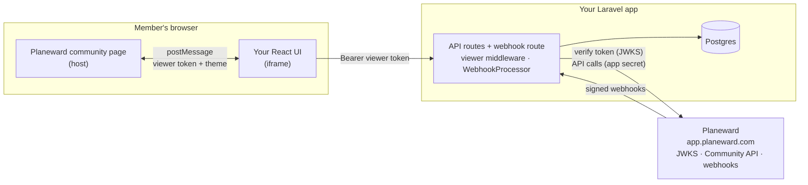
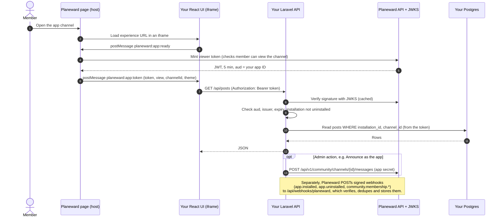

# Planeward App Template

A starter for building Planeward Community Apps with Laravel and React. Planeward shows your app in an iframe inside a community. It appears as a **member channel** (`/experience`) and a **staff dashboard** (`/dashboard`), and gets:

- a verified viewer identity (a short-lived signed token from the host),
- a Planeward API client,
- signed webhooks (`app.installed`, `app.uninstalled`, and more).

## Stack

- Laravel 13 (PHP 8.3+) for the pages, API routes and webhooks.
- React 19 and TypeScript, built by Vite through `laravel-vite-plugin`.
- shadcn/ui components and Tailwind v4.
- PostgreSQL through Eloquent and Laravel migrations.
- `@planeward/app-sdk` from npm for the iframe handshake in the browser. The server side of the SDK (token verification, webhooks, API client) is ported to PHP in `app/Planeward`.

## Layout

| Path                               | What it is                                                                      |
| ---------------------------------- | ------------------------------------------------------------------------------- |
| `app/Planeward`                    | Viewer token verification, the Planeward API client, webhook processing         |
| `app/Http/Middleware`              | `RequireViewer`, registered as the `viewer` route middleware                    |
| `app/Http/Controllers`             | Pages, the Board example, dashboard, members, announce and the webhook route    |
| `app/Http/Resources`               | JSON shapes the React code reads                                                |
| `app/Models`                       | `Installation`, `WebhookDelivery`, `Post`                                       |
| `database/migrations`              | Schema                                                                          |
| `routes/web.php`, `routes/api.php` | Page routes and API routes                                                      |
| `resources/js`                     | React app: `pages/`, `components/`, `components/ui/` (shadcn), `planeward/`     |
| `resources/views/app.blade.php`    | The one Blade shell every page renders                                          |
| `tests`                            | PHPUnit tests (`php artisan test`); React tests sit next to their code (Vitest) |

## Quickstart

Requires PHP 8.3+ with the `pdo_pgsql` extension, Composer, Node 24+, pnpm 11, Docker and a tunnel ([cloudflared](https://developers.cloudflare.com/cloudflare-one/connections/connect-networks/downloads/) or [ngrok](https://ngrok.com/download)).

Planeward is hosted at `https://app.planeward.com`. It loads your app in an iframe and sends it webhooks, so it must reach your app over public `https`. It rejects `localhost` URLs, so during development you expose your dev server through a tunnel.

1. Install and start the app:

   ```bash
   composer install
   pnpm install
   cp .env.example .env
   php artisan key:generate
   docker compose up -d   # Postgres on :5433
   php artisan migrate
   pnpm dev               # app on http://localhost:3005
   ```

   `pnpm dev` runs `php artisan serve --port=3005` and `vite build --watch` together. Vite writes the assets to `public/build`, so Laravel serves the pages and their assets from one origin and they load through the tunnel. Reload the page after an edit; there is no hot reload inside the iframe.

2. In another terminal, start a tunnel to port 3005:

   ```bash
   cloudflared tunnel --url http://localhost:3005   # prints https://<random>.trycloudflare.com
   # or
   ngrok http 3005                                  # prints https://<random>.ngrok-free.app
   ```

3. Open the setup page through the tunnel (`https://abc-123.trycloudflare.com/`). It shows which env vars are set and the exact URLs to register.

## Register in Planeward

1. In **Settings › Apps › Developer**, create an app with your tunnel origin:
   - Experience URL: `https://abc-123.trycloudflare.com/experience`
   - Dashboard URL: `https://abc-123.trycloudflare.com/dashboard`
   - Webhook URL: `https://abc-123.trycloudflare.com/api/webhooks/planeward`
   - Both scopes: **Community, read members** (`COMMUNITY_MEMBERS_READ`) and **Community, post messages as the app** (`COMMUNITY_MESSAGES_WRITE`).
2. Copy the app ID, app secret and webhook secret into `.env` (`PLANEWARD_APP_ID`, `PLANEWARD_APP_SECRET`, `PLANEWARD_WEBHOOK_SECRET`). Planeward shows them once. If you lose them, rotate them from the app's menu. Restart `pnpm dev`.
3. Install it from the install link (or **Install into this workspace**). Installing needs a workspace with **Community** turned on (Business plan or higher).
4. In **Community › Apps**, add it as a channel. Members see it in the community sidebar. Staff open the dashboard from **Community › Apps**.

The app verifies viewer tokens against `https://app.planeward.com/api/auth/jwks` and calls Planeward with your app secret. Both are outbound requests, so they work from your machine.

Use one Planeward app per environment, for example "My App (dev)" pointing at your tunnel and "My App" pointing at production. A token issued for a different app fails with `Token is for app "<aud>", but this backend expects "<appId>". Check PLANEWARD_APP_ID.`

### Tunnel tips

- Quick tunnels get a new URL every run, so you would edit the app's URLs (in its menu, **Edit**) each time. For a stable URL, use a named Cloudflare tunnel on your own domain or a reserved ngrok domain.
- Planeward retries webhooks (`app.installed`, `app.uninstalled`, `community.membership.*`) after 1 min, 10 min, 1 h and 6 h, so events sent while your tunnel was down arrive later.
- Run the tunnel only while you need it, and never commit `.env`.

## Deploying

Deploy to any host that runs PHP 8.3+ behind public `https`, with a Postgres database (Laravel Cloud, Forge, a container on Railway or Fly, and so on):

1. Set `APP_KEY`, `APP_ENV=production`, `APP_DEBUG=false`, `DB_URL`, and `PLANEWARD_APP_ID`, `PLANEWARD_APP_SECRET`, `PLANEWARD_WEBHOOK_SECRET` for your production Planeward app. `PLANEWARD_BASE_URL` defaults to `https://app.planeward.com`.
2. Build: `composer install --no-dev --optimize-autoloader`, `pnpm install --frozen-lockfile`, `pnpm build`, then `php artisan config:cache` and `php artisan route:cache`.
3. Run `php artisan migrate --force` against the production database.
4. Point the production Planeward app at the deployed URLs (`/experience`, `/dashboard`, `/api/webhooks/planeward`).
5. Do not add `X-Frame-Options` or a restrictive `frame-ancestors`. Communities can live on custom domains.

## How it works

### Where things run



In development, Planeward reaches your machine through the tunnel. `https://<tunnel>` forwards to `http://localhost:3005`, which serves the iframe pages, their assets and the API routes.

### One request, step by step



### In short

1. **Handshake.** Laravel renders `app.blade.php`, which mounts the React page. `PlanewardProvider` runs a `postMessage` handshake with the host, which returns the context, theme and a short-lived **viewer token** (a JWT that Planeward signs with `aud` set to your app ID).
2. **Viewer token.** `useViewerFetch()` sends that token as `Authorization: Bearer <token>` on every call to your own API.
3. **`viewer` middleware.** Every API route sits behind `viewer` (or `viewer:admin` for staff). `RequireViewer` verifies the token against `PLANEWARD_BASE_URL` and `PLANEWARD_APP_ID` and either stores the claims on the request or returns a 401/403 JSON response. Controllers read them with `Viewer::from($request)`.
4. **Scoping.** `installationId` and `channelId` come **only** from the verified claims. The Board reads and writes `posts` by those ids, so one community never sees another's data. `Planeward::forViewer($viewer)` builds the API client for the claims' installation.
5. **Webhooks.** `/api/webhooks/planeward` goes through `WebhookProcessor`. It checks the HMAC on the raw body, dedupes on `x-planeward-delivery` (stored in `webhook_deliveries`), records installs and uninstalls in `installations`, then dispatches the `WebhookReceived` event for your listeners.

## Laravel notes for this app

- **No sessions or cookies.** Browsers block third-party cookies in a cross-origin iframe, so `bootstrap/app.php` removes the session, cookie and CSRF middleware from the `web` group. API routes are stateless and authenticate each request with the viewer token. Don't add Sanctum, `auth` middleware or form posts that rely on a session.
- **Validation errors are 400 `{ "error": "..." }`**, not Laravel's default 422, because the React code reads `error`. Controllers use `Validator::make` and `ApiError::make`.
- **Trusted proxies.** `trustProxies(at: '*')` lets the app see `https` and the public host behind a tunnel or load balancer. Without it, asset URLs come out as `http://` and the browser blocks them.
- **React pages.** `PageController` renders `app.blade.php` with a page name, and `resources/js/app.tsx` mounts the matching component from `resources/js/pages`. Pass server data as the third argument of `page()`. The setup page is the only one that uses it.

## Security notes

- **One app ID per deployment.** The middleware checks tokens against `PLANEWARD_APP_ID` (`aud`). A token for another app fails with `Token is for app "<aud>", but this backend expects "<appId>". Check PLANEWARD_APP_ID.`
- **Never trust ids from request bodies.** Use `$viewer->installationId` and `$viewer->channelId`, not values the client sends.
- **Don't rely on cookies in the iframe.** Authenticate each request with the viewer token.
- **Leave the app frameable.** Don't set `X-Frame-Options`, and leave `frame-ancestors` open, because communities can run on custom domains.
- **Keep secrets server-only.** `PLANEWARD_APP_SECRET` and `PLANEWARD_WEBHOOK_SECRET` live in `.env` and `config/planeward.php`. Never pass them to a Blade view or a `VITE_` variable.
- **Webhooks only process after signature verification.** Unsigned or tampered deliveries get a 401 and nothing is stored.
- **Production webhook URLs must be public https.** `localhost` works only behind a tunnel during development.

## Customizing

- Replace the Board example (`PostController`, `Post`, the `posts` table and `resources/js/components/board.tsx`) with your feature. Keep the `viewer` middleware and claims-derived ids on every route.
- Add tables with `php artisan make:migration`, then run `php artisan migrate`.
- React to other webhooks by listening for `App\Planeward\Webhooks\WebhookReceived`. See `PlanewardWebhookController` for an example.

## Scripts

| Command                              | What it does                                    |
| ------------------------------------ | ----------------------------------------------- |
| `pnpm dev`                           | Laravel on port 3005 plus `vite build --watch`  |
| `pnpm build`                         | Build the React assets into `public/build`      |
| `php artisan test`                   | PHPUnit tests                                   |
| `pnpm test`                          | Vitest tests for the React code                 |
| `pnpm typecheck` / `pnpm lint`       | TypeScript and ESLint                           |
| `vendor/bin/pint`                    | Format PHP (`--test` to check only)             |
| `pnpm format:check` / `format:write` | Prettier for TypeScript, CSS, JSON and Markdown |
| `php artisan migrate`                | Apply migrations                                |
